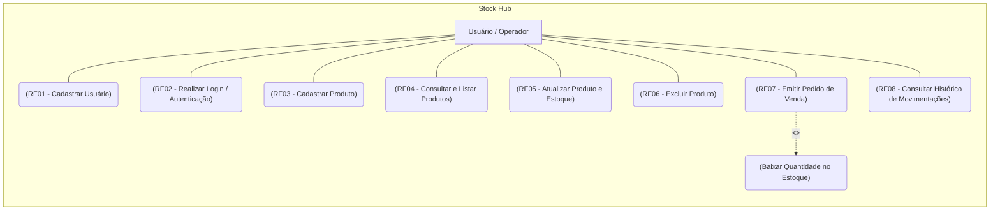

# Stock Hub
📦 O StockHub é uma solução centralizada e intuitiva desenvolvida para otimizar, simplificar e automatizar a gestão de inventários e processos logísticos. <br>
🎯 O objetivo do sistema é oferecer total visibilidade sobre o fluxo de mercadorias, permitindo um controlo preciso desde a entrada de produtos até ao acompanhamento de métricas de desempenho.

## 1. Funçõs do projeto

- <strong>Cadastrar produtos (CREATE):  </strong> Para começar, o usuário deverá cadastrar um produto para que ele apareça na lista de estoque. No cadastro, será possível informar dados como:
    - Nome do produto
    - SKU
    - Valor final
    - Fonecedor
    - Valor de compra
    - Estoque <br>

    Após cadastrado, o produto poderá ser consultado e atualizado sempre que necessário.

- <strong>Produtos cadastrados (READ): </strong> Nesta aba, o usuário poderá visualizar todos os produtos cadastrados no estoque, consultar suas principais informações e acompanhar a quantidade disponível de cada item.

- <strong>Informações de um produto mais detalhado (READ_WHERE): </strong>
Nesta aba, o usuário poderá visualizar todas as informações de um produto específico, como nome, código, categoria, quantidade, preço, fornecedor e localização no estoque.


- <strong>Deletar um produto (DELETE): </strong>Nesta opção, o usuário poderá excluir um produto cadastrado no estoque, removendo suas informações da lista de produtos.

- <strong>Atualizar um produto (UPDATE): </strong> Nesta opção, o usuário poderá editar as informações de um produto já cadastrado, como nome, categoria, quantidade, preço, fornecedor e localização no estoque.

    Ainda partindo do princípio de atualizar um produto, ele vai conseguir atualizar somente o estoque podendo registrar a entrada e a saida dele para conseguirmos alterar o estoque, e isso ficará salvo para que ele possa ver o que siau e o que entrou.

Dessa dorma conseguimos fazer um site com um CRUD completo.

## 2.1 Requisitos Funcionais

### RF01 - Cadastro de Usuários
O sistema deve permitir o cadastro de novos usuários para garantir a segurança e o acesso restrito apenas a pessoas autorizadas.

### RF02 - Autenticação de Usuários (Login)
O sistema deve permitir que os usuários cadastrados realizem login para acessar as funcionalidades restritas do sistema.

### RF03 - Cadastrar Produto (Create)
O sistema deve permitir a inclusão de novos produtos no inventário, solicitando informações como nome, SKU/código, categoria, fornecedor, valor de compra, valor de venda, localização e quantidade inicial.

### RF04 - Consultar e Listar Produtos (Read)
O sistema deve permitir a visualização de todos os produtos cadastrados em forma de lista ou tabela, bem como a exibição detalhada das informações de um produto específico.

### RF05 - Atualizar Produto e Estoque (Update)
O sistema deve permitir a edição de todas as informações de um produto previamente cadastrado, além de possibilitar o ajuste direto na quantidade do estoque (registrar entrada ou saída manual).

### RF06 - Excluir Produto (Delete)
O sistema deve permitir a remoção permanente ou desativação de um produto da lista de inventário.

### RF07 - Emissão de Pedido de Venda
O sistema deve permitir a criação e emissão de pedidos de venda, realizando a baixa automática da quantidade do produto no estoque.

### RF08 - Histórico de Movimentação de Estoque
O sistema deve registrar e exibir o histórico completo de entradas e saídas de cada produto, permitindo ao usuário visualizar a data, a quantidade movimentada e o tipo da operação (entrada por compra/recomposição ou saída por venda/perda).

## 2.2 Requisitos Não Funcionais

### RNF01 - Usabilidade
O sistema deve ter uma interface web simples, limpa e responsiva, permitindo que os usuários realizem as operações de cadastro e consulta de forma intuitiva tanto em computadores quanto em dispositivos móveis.

### RNF02 - Compatibilidade
O sistema deve ser acessível através de navegadores web modernos (como Google Chrome, Mozilla Firefox, Microsoft Edge e Safari), sem a necessidade de instalação de plugins adicionais.

## 3. Organização das tabelas.

``` mermaid

--- 
Title: Estoque
---

erDiagram
    produtos {
        int ID PK "AUTO INCREMENT"
        int ID_estoque FK "NOT NULL"
        VARCHAR(50) SKU "NOT NULL"
        VARCHAR(200) nome_produto "NOT NULL"
        DECIMAL(10,2) valor_final "NOT NULL"
        DECIMAL(10,2) valor_entrada "NOT NULL"
        VARCHAR(255) descricao "NOT NULL"
        VARCHAR(13) codigo_barra "NOT NULL"

    }

    estoque {
        int ID PK "AUTO INCREMENT"
        int quantidade_estoque "NOT NULL"
        VARCHAR(150) fornecedor "NOT NULL"
        VARCHAR(50) SKU "NOT NULL"
        VARCHAR(13) codigo_barra "NOT NULL"


    }

    login {
        int ID PK "AUTO INCREMENT"
        VARCHAR(200) nome "NOT NULL"
        VARCHAR(255) email "NOT NULL"
        VARCHAR(14) cpf "NOT NULL"
        VARCHAR(255) senha "NOT NULL"
    }

    cliente{
        int ID PK "AUTO INCREMENT"
        VARCHAR(255) nome_cliente "NOT NULL"
        VARCHAR(14) cpf "NOT NULL"
        VARCHAR(20) telefone "NOT NULL"
        VARCHAR(255) endereco "NOT NULL"
    }

    vendedor{
        int ID PK "AUTO INCREMENT"
        VARCHAR(255) nome_vendedor "NOT NULL"
        VARCHAR(14) cpf "NOT NULL"
    }
    vendas{
        int ID PK "AUTO INCREMENT"
        VARCHAR(50) nome_cliente "NOT NULL"
        VARCHAR(50) nome_vendedor "NOT NULL"
        VARCHAR(50) nome_produto"NOT NULL"
        number quantidade "NOT NULL"
        date data_venda "NOT NULL"
    }   
    
    produtos ||--o{ vendas : "geram"
    login ||--o{ produtos : "cadastra"
    estoque ||--|| produtos : "pertence a"
    vendedor ||--o{ vendas : "realiza"
    cliente ||--o{ vendas : "comtem em"
```

## Fluxo de funcionamento



## Dicionário de Dados

| NOME DA TABELA | NOME DO CAMPO | DESCRIÇÃO DO CAMPO | TIPO DE DADO | MÁSCARA | OPÇÕES DE COLUNA | 
| ----- | ----- | ----- | ----- | ----- | ----- | 
| **produtos** | `id_produtos` | PK para identificar o produto | `int` | `0-9` | `NOT NULL` | 
|  | `sku` | Identificar o sku do produto fornecido pelo fornecedor | `varchar(50)` | `A-Z` | `NOT NULL` | 
|  | `nome_produto` | Nome para identificar o produto | `varchar(200)` | `A-Z` | `NOT NULL` | 
|  | `descricao` | Descrição do produto | `varchar(255)` | `A-Z` | `NOT NULL` | 
|  | `codigo_barra` | Código de barras do produto | `varchar(13)` | `0-9` | `NOT NULL` | 
|  | `valor_entrada` | Valor de quanto comprou o produto | `decimal(10,2)` | `A-Z` | `NOT NULL` | 
|  | `valor_final` | Valor de quanto vai ser vendido o produto | `decimal(10,2)` | `A-Z` | `NOT NULL` | 
|  | `id_estoque` | FK para identificar o estoque do produto | `int` | `0-9` | `NOT NULL` | 
| **estoque** | `id_estoque` | PK para identificar o produto em estoque | `int` | `0-9` | `NOT NULL` | 
|  | `sku` | SKU para identificar o produto | `varchar(13)` | `0-9` | `NOT NULL` | 
|  | `codigo_barra` | Código de barras do produto para estoque | `varchar(50)` | `A-Z` | `NOT NULL` | 
|  | `quantidade_estoque` | Quantidade de produto que tem em estoque | `int` | `0-9` | `NOT NULL` | 
|  | `fornecedor` | Nome do fornecedor do produto | `varchar(255)` | `A-Z` | `NOT NULL` | 
| **login** | `id_login` | PK para identificar o id de login | `int` | `0-9` | `NOT NULL` | 
|  | `nome` | Nome do funcionário | `vachar(200)` | `A-Z` | `NOT NULL` | 
|  | `email` | E-mail do funcionário | `varchar(255)` | `A-Z` | `NOT NULL` | 
|  | `cpf` | CPF do funcionário | `varchar(14)` | `0-9` | `NOT NULL` | 
|  | `senha` | Senha de login do funcionário | `varchar(255)` | `A-Z` | `NOT NULL` | 
| **cliente** | `id_cliente` | PK para identificar o id do cliente | `int` | `0-9` | `NOT NULL` | 
|  | `nome_cliente` | Nome do cliente | `varchar(255)` | `A-Z` | `NOT NULL` | 
|  | `cpf` | CPF do cliente | `varcha(14)` | `0-9` | `NOT NULL` | 
|  | `telefone` | Telefone do cliente | `varchar(20)` | `0-9` | `NOT NULL` | 
|  | `endereco` | Endereço do cliente | `varchar(255)` | `A-Z` | `NOT NULL` | 
| **vendedor** | `id_vendedor` | PK para identificar o id do vendedor | `int` | `0-9` | `NOT NULL` | 
|  | `nome_vendedor` | Nome do vendedor | `varchar(255)` | `A-Z` | `NOT NULL` | 
|  | `cpf` | CPF do vendedor | `varchar(14)` | `0-9` | `NOT NULL` | 
| **vendas** | `id_venda` | PK para identificar o id das vendas | `int` | `0-9` | `NOT NULL` | 
|  | `nome_cliente` | FK para identificar qual o cliente fez a compra | `varchar(255)` | `A-Z` | `NOT NULL` | 
|  | `nome_vendedor` | FK para identificar o vendedor | `varchar(255)` | `A-Z` | `NOT NULL` | 
|  | `nome_produto` | FK para identificar qual produto foi vendido | `varchar(255)` | `A-Z` | `NOT NULL` | 
|  | `quantidade` | Quantidade do produto vendido | `number` | `0-9` | `NOT NULL` | 
|  | `data_venda` | Data de quando foi realizada a venda | `datetime` | `0-9` | `NOT NULL` |
